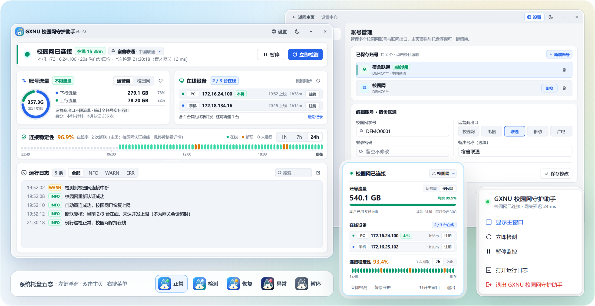
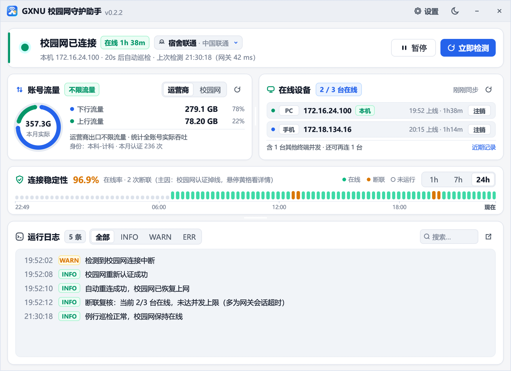

<p align="center">
  
</p>
<h1 align="center">GXNU Campus Network Helper</h1>
<p align="center">A lightweight Windows tray app for Guangxi Normal University’s Dr.COM campus network — multi-campus auto-reconnect (Yucai / Yanshan / Wangcheng), live traffic & device management, and 1-click multi-account switching</p>
<p align="center"><a href="README.md">简体中文</a> · <strong>English</strong></p>
<p align="center">
  <a href="https://github.com/junkaih2019/gxnu-campus-net-helper/releases/latest"><strong>⬇️ Download Portable Windows x64 (.exe)</strong></a>
  &nbsp;·&nbsp; <a href="CHANGELOG.md">Changelog</a>
  &nbsp;·&nbsp; <a href="docs/CONFIGURATION.md">Configuration</a>
  &nbsp;·&nbsp; <a href="docs/ARCHITECTURE.md">Architecture</a>
  &nbsp;·&nbsp; <a href="LICENSE">MIT License</a>
</p>
<p align="center">
  <sub>Windows 10 / 11 x64 · Single portable executable · Yucai / Yanshan / Wangcheng multi-campus · Supports Campus / Telecom / Unicom / Mobile / Broadnet exits</sub>
</p>

---

## ✨ Interface Overview

<p align="center">
  <picture>
    <source media="(prefers-color-scheme: dark)" srcset="docs/images/readme-overview-dark.png">
    <source media="(prefers-color-scheme: light)" srcset="docs/images/readme-overview-light.png">
    
  </picture>
</p>

<details>
<summary>🖼️ Expand individual screenshots (Light / Dark Dashboard, Tray Flyout, Context Menu & Settings Center)</summary>

| Light Dashboard (Carrier view) | Dark Dashboard (Carrier view) |
| :---: | :---: |
| [](docs/images/main-window-light.png) | [](docs/images/main-window.png) |

| Campus Quota & Multi-device Management | Settings Center (Multi-account & 5 Exits) |
| :---: | :---: |
| [](docs/images/main-window-campus.png) | [](docs/images/settings-dark.png) |

| Left-click · Quick Tray Flyout | Right-click · Context Menu |
| :---: | :---: |
| [](docs/images/tray-flyout-light.png) | [](docs/images/tray-menu-light.png) |

</details>

---

## 💡 Key Features

- 🔄 **Zero-Config Multi-Campus Auto-Reconnect**: Automatically discovers and switches across **Yucai / Yanshan / Wangcheng** Dr.COM gateways (with an optional custom gateway fallback), signing back in after sleep/wake, Wi-Fi switches, or session timeouts with clear diagnostics.
- 📊 **Live Traffic & Device Sign-Out**: Syncs with GXNU Self-Service to toggle **Carrier throughput / Campus quota**, inspect recent session history, deduplicate dual-BRAS sessions, and **sign out (`注销`) occupying devices** in one click.
- ⚡ **Instant Left-click Tray Flyout**: Single-click the tray icon for a minimalist native flyout to switch accounts, inspect traffic, sign out devices, and check stability without opening the main window.
- 👥 **Dual-Exit Setup, Multi-Account Switch & VPN Guard**: Pair Carrier + Campus (`校园网`) exits in one click, add extra exits for the same student ID without retyping credentials, and auto-sync password updates across peer exits; warns to close VPN/proxy software before switching to the Campus exit.
- 📈 **Uptime Timeline**: Tracks `1h / 7h / 24h` connection stability in a capsule strip with hover details for outages.
- ⬆️ **In-Place Self-Update**: Periodically checks GitHub Releases, verifies SHA-256 checksums, and replaces the `.exe` in place while preserving all credentials and startup settings.
- 🛡️ **Proxy-Friendly & Ultra-Light**: Pierces Clash / Mihomo TUN adapters for portal probes, encrypts passwords in Windows Credential Manager, idles at **~3 MB** in the system tray, uses only **~41 MB** private memory when the dashboard is open (via zero-copy memory-mapped system fonts), and frees all UI/GPU memory when closed.

---

## 🚀 Quick Start

1. **Download & Run**: Grab **`gxnu-campus-net-helper-v0.2.6.exe`** from [Releases](https://github.com/junkaih2019/gxnu-campus-net-helper/releases/latest), place it in a **permanent folder**, and run it directly (no installer or extraction needed).
   > 💡 If Windows SmartScreen appears on first launch, click **More info → Run anyway** (you can verify the hash against `SHA256SUMS.txt` on the release page).
2. **Add Account**: Enter your student ID and password on the left, select your exit (`校园网 / 电信 / 联通 / 移动 / 广电`) on the right — optionally keeping **同时生成「校园网」快捷切换项** checked to pair both exits at once — and click **验证并添加账号 (Verify & Add)**; adding extra exits for the same student ID later requires no password re-entry.
3. **Everyday Use**:
   - **Close the main window (`×`)** anytime to keep monitoring silently in the tray with minimal RAM;
   - **Left-click** the tray icon for the quick flyout, **double-click** for the main window, or **right-click** for the context menu;
   - Enable **Start at sign-in** under **设置 → 监控与自启** if needed (Yucai / Yanshan / Wangcheng gateways are detected automatically with zero setup).

### Tray 5-State Indicators

|  Online |  Checking |  Recovering |  Offline |  Paused |
| :---: | :---: | :---: | :---: | :---: |
| Internet OK | Routine probe | Recheck / Sign-in / Verify | Disconnected or rejected | Monitoring paused |

---

## ❓ FAQ

- **Do I need to reconfigure anything when moving between Yucai, Yanshan, and Wangcheng campuses?**  
  No. Multi-campus gateway discovery runs automatically — racing campus gateways and sniffing captive-portal redirects with strict GXNU subnet & protocol verification (never leaking credentials on public Wi-Fi or home routers). For special lab subnets, a collapsible **Custom (`自定义`)** override is available under **设置 → 监控与自启 → 认证网关**.
- **Why are there both "Carrier" (`运营商`) and "Campus" (`校园网`) traffic views?**  
  Carrier broadband exits (Telecom / Unicom / Mobile / Broadnet) are unmetered, whereas the self-service package quota only applies to the Campus (`校园网`) exit. The app defaults to your active exit and lets you toggle anytime.
- **Does it conflict with Clash / Mihomo (TUN mode)?**  
  Not on Carrier exits — probes, portal logins, and self-service queries bypass system proxies and pierce virtual TUN adapters. When using the **Campus (`校园网`)** exit, please close VPN/proxy tools first as prompted to avoid campus anti-proxy account suspension.
- **Where is my data stored, and how do I upgrade or uninstall?**  
  Passwords are encrypted in Windows Credential Manager; config and logs live in `%LOCALAPPDATA%\GXNUCampusLogin\`. **To upgrade**, click the new-version badge in the titlebar (or **设置 → 监控与自启 → 检查更新**) for 1-click in-place self-update. **To uninstall**, disable auto-start, quit from the tray, and delete the `.exe` and data folder.

---

## 🛠️ Advanced & Docs

<details>
<summary>⌨️ Command-Line Options & Building from Source</summary>

### Command-Line Options

| Option | Description |
| :--- | :--- |
| `--minimized --start` | Launch silently into the system tray and start monitoring immediately |
| `--once` | Run a single read-only diagnostic check (`0` online, `2` offline, `3` route changed) |
| `--autostart on \| off \| status` | Enable, disable, or query startup at Windows sign-in |
| `--test-toast` | Send a test Windows notification |

### Build from Source (Windows x64 + MinGW-w64)

```powershell
rustup toolchain install stable-x86_64-pc-windows-gnu --component rustfmt --component clippy
rustup override set stable-x86_64-pc-windows-gnu
.\build.ps1 verify
.\build.ps1 release
```

</details>

- 📖 [Configuration (Chinese)](docs/CONFIGURATION.md) · [Architecture (Chinese)](docs/ARCHITECTURE.md) · [Changelog (Chinese)](CHANGELOG.md)
- 🤝 [Contributing](CONTRIBUTING.md) · [Issues](https://github.com/junkaih2019/gxnu-campus-net-helper/issues) · [Security](SECURITY.md) · [MIT License](LICENSE)
