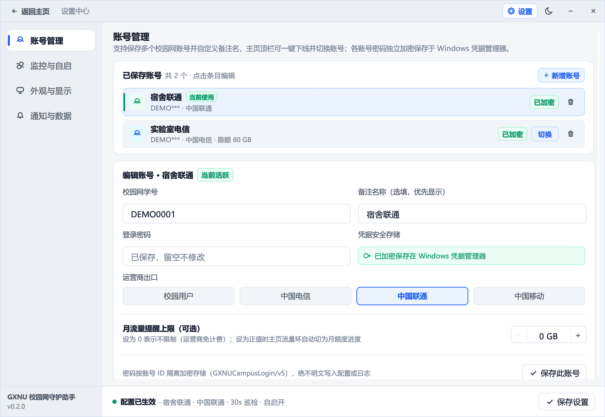

<p align="center">
  
</p>
<h1 align="center">GXNU Campus Network Helper</h1>
<p align="center">A lightweight Windows tray app for Guangxi Normal University’s Dr.COM campus network. Auto-reconnect, uptime & outage tracking, local traffic stats, and 1-click multi-account switching.</p>
<p align="center"><a href="README.md" lang="zh-CN">简体中文</a> · <strong>English</strong></p>
<p align="center">
  <a href="https://github.com/junkaih2019/gxnu-campus-net-helper/releases/latest"><strong>Download Portable Windows x64</strong></a>
  &nbsp;·&nbsp; <a href="CHANGELOG.md">Changelog (Chinese)</a>
  &nbsp;·&nbsp; <a href="docs/CONFIGURATION.md">Configuration (Chinese)</a>
  &nbsp;·&nbsp; <a href="docs/ARCHITECTURE.md">Architecture (Chinese)</a>
  &nbsp;·&nbsp; <a href="LICENSE">MIT License</a>
</p>
<p align="center">
  <sub>Windows 10 / 11 x64 · Single portable executable · No admin required · Built in Rust</sub>
</p>

## Preview

<p align="center">
  <picture>
    <source media="(prefers-color-scheme: dark)" srcset="docs/images/main-window.png">
    <source media="(prefers-color-scheme: light)" srcset="docs/images/main-window-light.png">
    
  </picture>
</p>

The preview adapts automatically to GitHub’s light or dark theme. Screenshots use simulated `DEMO` accounts and network data.

<details>
<summary>Compare light / dark themes and Settings Center</summary>

| Light dashboard | Dark dashboard |
| :---: | :---: |
| [](docs/images/main-window-light.png) | [](docs/images/main-window.png) |

| Settings Center (Light) | Settings Center (Dark) |
| :---: | :---: |
| [](docs/images/settings-light.png) | [](docs/images/settings-dark.png) |

Select any screenshot to view it at full size.

</details>

## Features

- **Tiny background footprint; closing the window frees UI memory.** A single Rust executable runs two separate modes. Open the dashboard on demand; closing it (`×`) exits the UI process immediately and releases OpenGL driver and CJK font memory, leaving only the pure Win32 tray monitor silently running in the background. [Architecture details (Chinese)](docs/ARCHITECTURE.md)
- **Layered diagnostics with false-positive protection.** Switching Wi-Fi, plugging/unplugging Ethernet, or waking from sleep waits for the route to settle and checks adapter → route → public probes → campus portal in order:
  - Signs in only when the campus session is confirmed offline, then re-verifies public connectivity.
  - Requires consecutive failed checks to filter brief blips; reports an upstream outage without re-submitting credentials when the portal still reports an active session.
  - Backs off progressively (`5s → 15s → 30s → 60s → 300s`) on sign-in rejection and alerts you after repeated rejections.
- **Multi-account profiles, custom remarks, and 1-click switching.** Save multiple campus accounts with custom remarks (displayed preferentially in the header and tray menu). Click the account chip on the Home status ribbon to switch accounts atomically: the daemon validates target credentials first, logs out via Dr.COM `/drcom/logout`, signs in to the new account, and runs two-stage connectivity verification. Each account’s password is stored in its own Windows Credential Manager entry (`GXNUCampusLogin/v5/<id>`) with seamless legacy `v4` migration.
- **Fine-grained capsule stability timeline & outage tracing.** Inspect **1h / 7h / 24h** uptime with a fine-grained capsule health timeline (green online, amber outage slots). Hover any outage capsule or event row for a structured detail card, with bidirectional hover linking between the timeline and the scrollable outage list.
- **Physical NIC traffic stats (optional home card).** Samples physical network adapter deltas while online (automatically excluding Clash / Mihomo / Tailscale virtual TUN interfaces), showing a dual-mode adaptive donut chart (today/month split or optional monthly quota ring) and 7-day bars. Hide the traffic card in **Settings → Appearance & Display** if you use an unmetered carrier exit—the stability panel automatically expands into a wide dual-column layout.
- **Denoised, human-readable logs.** Strictly separated into **`ALL / INFO / WARN / ERR`** with automatic filtering of toast echoes and intermediate handshake noise. Long lines truncate cleanly with hover detail cards and click-to-copy.
- **Global UI zoom, draggable splitters & Windows 11 Fluent Settings.** Adjust global zoom (`75%–125%` via Settings, `Ctrl + / − / 0`, or `Ctrl + wheel`), pick window size presets, and drag horizontal/vertical splitters (double-click to reset). Settings are organized into a dedicated Fluent Settings Center (Accounts, Monitoring & Startup, Appearance & Display, Notifications & Data).
- **Proxy-friendly & privacy-first.** Probes and portal requests connect directly, bypassing proxy environment variables and virtual tunnel IPs. Passwords are stored exclusively via Windows DPAPI Credential Manager and never written to config files or logs.

## Compatibility

| Item | Support |
| :--- | :--- |
| Campus portal | Guangxi Normal University Dr.COM portal (`https://yc.gxnu.edu.cn`) |
| Carrier exits | Campus (`校园用户`), China Telecom (`中国电信`), China Unicom (`中国联通`), China Mobile (`中国移动`) |
| Platform | Windows 10 / 11 x64 (portable single `.exe`, no installer or admin rights needed) |

## Quick start

1. **Download and extract.** Download the latest Windows x64 ZIP from [GitHub Releases](https://github.com/junkaih2019/gxnu-campus-net-helper/releases/latest), extract it to a **permanent folder** (so startup paths remain valid), and run `GXNU 校园网守护助手.exe`.
   > Because this standalone open-source executable is unsigned, Windows SmartScreen may show a warning on first launch. Verify the `.sha256` checksum from the release first, then select **More info → Run anyway**.
2. **Add your account and start monitoring.** On first launch, the app opens **Settings → 账号管理 (Accounts)**. Enter your student ID, password, optional remark, and carrier exit, then click **保存并开始守护 (Save & start)** at the bottom-right.
3. **Add more accounts & switch in 1 click (optional).** Click **+ 新增账号 (Add account)** under **Settings → 账号管理**. On the Home view, click the account chip in the top status ribbon to switch accounts with one click.
4. **Startup & display preferences (optional).** Click **设置 (Settings)** in the top-right title bar:
   - Enable **开机自动启动到托盘** and **启动后立即开始监控** under **监控与自启** and save.
   - Customize light/dark theme, global UI zoom (`75%–125%`), window size presets, and whether to show the Home traffic card under **外观与显示**.

<details>
<summary>Upgrade from v0.1.x or verify a download</summary>

When upgrading from `v0.1.0` / `v0.1.1`:
1. Right-click the old tray icon and select **退出 GXNU 校园网守护助手** to exit the old daemon first;
2. Launch the new `v0.2.0` executable;
3. Existing single-account settings and `GXNUCampusLogin/v4` credentials migrate automatically.

If startup at sign-in was enabled and you moved the executable, refresh its registered path from PowerShell:

```powershell
& ".\GXNU 校园网守护助手.exe" --autostart on
```

Verify the downloaded ZIP against the release `.sha256` file:

```powershell
Get-FileHash .\gxnu-campus-net-helper-<version>-windows-x64.zip -Algorithm SHA256
```

</details>

## Everyday use and tray states

### Common actions

| Task | How to do it |
| :--- | :--- |
| Keep running in the background | Close the dashboard (`×`) to free UI memory while the tray monitor stays active. Click the tray icon to reopen. |
| Switch accounts in 1 click | Click the account chip in the Home status ribbon and choose another saved account from the dropdown. |
| Run a manual check anytime | Click **立即检测** in the Home status bar or the tray menu. |
| Run a read-only check | Click **暂停** (or **暂停监控** in the tray), then **立即检测**. No sign-in is attempted and monitoring stays paused. |
| Investigate an outage | Switch `1h / 7h / 24h`, hover amber timeline capsules or outage rows for details, and filter logs by `WARN / ERR` or keyword. |
| Resize & zoom UI | Press `Ctrl + / − / 0` or `Ctrl + wheel` to zoom (`75%–125%`); drag panel splitters freely (double-click to reset). |
| Toggle theme or quit | Click the sun/moon icon in the title bar to switch themes; right-click the tray icon and choose **退出 GXNU 校园网守护助手** to exit completely. |

### Tray menu and status icons

Right-click the blue tray icon to inspect the active account remark, live status, gateway latency, and quick controls (appearance follows your theme):

<p align="center">
  <picture>
    <source media="(prefers-color-scheme: dark)" srcset="docs/images/tray-menu.png">
    <source media="(prefers-color-scheme: light)" srcset="docs/images/tray-menu-light.png">
    
  </picture>
</p>

| Icon | Tooltip | Meaning |
| :---: | :--- | :--- |
|  | 网络正常 · Online | Internet probe succeeded. Routine checks continue at the configured interval. |
|  | 检测中 · Checking | A connectivity check is currently running. |
|  | 正在复核 / 正在登录 / 正在验证 | Rechecking a failure, signing in to the portal, or verifying internet access after sign-in. |
|  | 连接异常 · Offline | Confirmed offline. Open the dashboard to view the cause or verify credentials. |
|  | 已暂停 / 已停止 · Paused / Stopped | Automatic monitoring is inactive. Manual checks remain available. |

## FAQ

**Q: Does closing the main window exit the app? How do I quit completely?**  
Clicking `×` closes only the GUI process (releasing OpenGL and font memory), while the tray daemon keeps monitoring. To exit completely, right-click the tray icon and choose **退出 GXNU 校园网守护助手**.

**Q: Does it work alongside Clash / Mihomo (including TUN mode)?**  
Yes. Probes and portal requests bypass proxy environment variables and virtual tunnel IPs, and local traffic sampling excludes virtual TUN interfaces so only real physical adapter deltas are counted.

**Q: Where are credentials and data stored?**  
Per-account passwords are stored in Windows Credential Manager (`GXNUCampusLogin/v5/<id>`, with automatic `GXNUCampusLogin/v4` fallback). Settings, UI preferences, daily traffic stats, logs, and 48-hour telemetry live under `%LOCALAPPDATA%\GXNUCampusLogin\`.

**Q: How do I uninstall cleanly?**  
1. Disable **开机自动启动到托盘** under **设置 → 监控与自启** and save (or run `--autostart off`).
2. Right-click the tray icon and select **退出 GXNU 校园网守护助手**.
3. Delete the `.exe` file and `%LOCALAPPDATA%\GXNUCampusLogin\`. Optionally remove `GXNUCampusLogin/*` entries in **Control Panel → Credential Manager → Windows Credentials**.

For configuration schema details, see [Configuration and FAQ (Chinese)](docs/CONFIGURATION.md).

## Command line and building from source

### Command-line options

| Option | Effect |
| :--- | :--- |
| `--once` | Run one read-only diagnostic check without taking the single-instance lock or submitting credentials (`0` online, `2` offline, `3` route changed). |
| `--minimized` | Start silently in the tray without opening the dashboard. |
| `--start` | Start or resume monitoring immediately on launch (combinable with `--minimized`). |
| `--autostart on \| off \| status` | Enable, disable, or query startup at sign-in (`HKCU\...\Run`). |
| `--test-toast` | Send a test Windows notification. |

> **Note:** Release binaries use the Windows GUI subsystem; pipe through `Out-Host` in PowerShell to inspect stdout and `$LASTEXITCODE`:
> ```powershell
> & ".\GXNU 校园网守护助手.exe" --once | Out-Host; $LASTEXITCODE
> ```

<details>
<summary>Build the Windows x64 release from source</summary>

Install Rust and 64-bit MinGW-w64, add `gcc`/`dlltool`/`windres` to `PATH` (or set `MINGW_BIN`), and run:

```powershell
rustup toolchain install stable-x86_64-pc-windows-gnu --component rustfmt --component clippy
rustup override set stable-x86_64-pc-windows-gnu
.\build.ps1 verify
.\build.ps1 release
```

`verify` runs `rustfmt`, Clippy, tests, and a release build. `release` embeds the icon and version metadata and outputs `target\release\GXNU 校园网守护助手.exe`.

</details>

## Documentation and feedback

- [Architecture and diagnostics (Chinese)](docs/ARCHITECTURE.md)
- [Configuration and FAQ (Chinese)](docs/CONFIGURATION.md)
- [Changelog (Chinese)](CHANGELOG.md) · [Contributing (Chinese)](CONTRIBUTING.md) · [Issues](https://github.com/junkaih2019/gxnu-campus-net-helper/issues) · [Security reports (Chinese)](SECURITY.md) · [MIT License](LICENSE)
