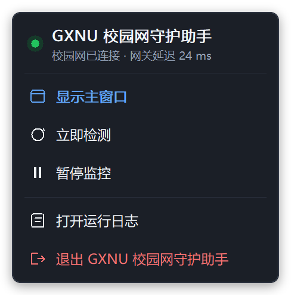

<p align="center">
  
</p>
<h1 align="center">GXNU Campus Network Helper</h1>
<p align="center">A Windows tray app for Guangxi Normal University’s campus network. Reconnect automatically, track latency, and see what caused an outage.</p>
<p align="center"><a href="README.md" lang="zh-CN">简体中文</a> · <strong>English</strong></p>
<p align="center">
  <a href="https://github.com/junkaih2019/gxnu-campus-net-helper/releases/latest"><strong>Download for Windows x64</strong></a>
  &nbsp;·&nbsp; <a href="CHANGELOG.md">Changelog (Chinese)</a>
  &nbsp;·&nbsp; <a href="LICENSE"></a>
</p>

## What you can do

- **Reconnect after an outage.** The helper checks the network adapter, route, internet connection, and campus portal session. When a sign-in is needed, it uses your saved account, then checks internet access again to confirm recovery. Enable Windows notifications to see when the connection drops or returns.
- **See when your connection dropped.** The dashboard plots campus portal response times over the last **1, 7, or 24 hours**. Match a gap in the connection timeline to an outage record, then filter the log by time, severity, or keyword.
- **Control monitoring from the tray.** Right-click the tray icon to run a check, pause or resume monitoring, or open the log. Closing the dashboard leaves monitoring running in the background. Click the tray icon to reopen it.

## How it handles campus network problems

| Situation | What the helper does |
| --- | --- |
| You switch from Wi-Fi to Ethernet or wake the computer from sleep | It waits for the route to settle before checking again, reducing false alerts and unnecessary sign-ins. |
| Websites stop loading while your campus session is still active | It compares internet probes with the portal’s session status. If the portal confirms you are online, it reports an upstream connection problem and waits for recovery without resubmitting your password. |
| The portal repeatedly rejects your account or carrier | It retries the first rejection silently. Repeated rejections prompt you to check your account, and the retry interval grows to a maximum of five minutes. |
| You want a one-off connection check | Pause monitoring and select **立即检测** (Check now). The helper runs one read-only check and stays paused. |

## Get started

1. Open Releases using the download link above. Download the Windows x64 ZIP, extract it to a folder you plan to keep, and run `GXNU 校园网守护助手.exe`.
2. Under **账号与网络** (Account and network), enter your campus student ID and password, select your carrier, and click **保存并开始守护** (Save and start monitoring).
3. To launch the app at Windows sign-in, open **监控** (Monitoring) and enable **开机自动启动到托盘** (Start in the tray). To begin checking the connection whenever the app launches, also enable **启动后立即开始监控** (Start monitoring on launch).

To quit completely, right-click the tray icon and select **退出 GXNU 校园网守护助手** (Exit).

<details>
<summary>Upgrade from v0.1.0 or verify a download</summary>

When upgrading from v0.1.0, quit the old version from its tray menu before opening the new executable. If you had enabled startup at sign-in, run this PowerShell command from the new executable’s folder to update its registered path.

```powershell
& ".\GXNU 校园网守护助手.exe" --autostart on
```

Each release includes a `.sha256` file. For v0.1.1, run the following command and compare the hash with the one in the matching checksum file.

```powershell
Get-FileHash .\gxnu-campus-net-helper-0.1.1-windows-x64.zip -Algorithm SHA256
```

</details>

## Screenshots

**Dashboard** · Account settings, portal latency, outage history, and logs share one screen. The `DEMO` account and network history in this screenshot are sample data.


**Tray menu** · The menu shows the current monitoring state. Here monitoring is paused, and a one-off check is still available.



## Data and privacy

Passwords are stored in Windows Credential Manager for the current user. Your student ID and preferences are saved in `%LOCALAPPDATA%\GXNUCampusLogin\config.json`. The application directory also contains logs and recent network history. When reporting an issue, share only the relevant log lines and redact student IDs, device names, IP addresses, and personal paths. [Configuration and FAQ (Chinese)](docs/CONFIGURATION.md)

## Command line and source builds

Open PowerShell in the executable’s folder to use these options.

| Option | Effect |
| --- | --- |
| `--once` | Run one read-only check. Exit code 0 means online, 2 means offline, and 3 means the route changed during successive samples. |
| `--minimized` / `--minimized --start` | Start in the tray. Add `--start` to begin or resume monitoring in the background. |
| `--test-toast` | Send a test Windows notification. |
| `--autostart status` | Show whether startup at sign-in is enabled. |

For example, run `& ".\GXNU 校园网守护助手.exe" --once` to check the connection once.

<details>
<summary>Build the Windows x64 release from source</summary>

Install Rust and MinGW-w64. Put the directory containing `gcc`, `dlltool`, and `windres` on PATH, then run the following commands from the repository root.

```powershell
rustup toolchain install stable-x86_64-pc-windows-gnu --component rustfmt --component clippy
rustup override set stable-x86_64-pc-windows-gnu
.\build.ps1 verify
.\build.ps1 release
```

`verify` runs the formatting check, Clippy, tests, and a release build. `release` produces `target\release\GXNU 校园网守护助手.exe`.

</details>

[Architecture and diagnostics (Chinese)](docs/ARCHITECTURE.md) · [Contributing (Chinese)](CONTRIBUTING.md) · [Security reports](SECURITY.md) · [MIT License](LICENSE)
