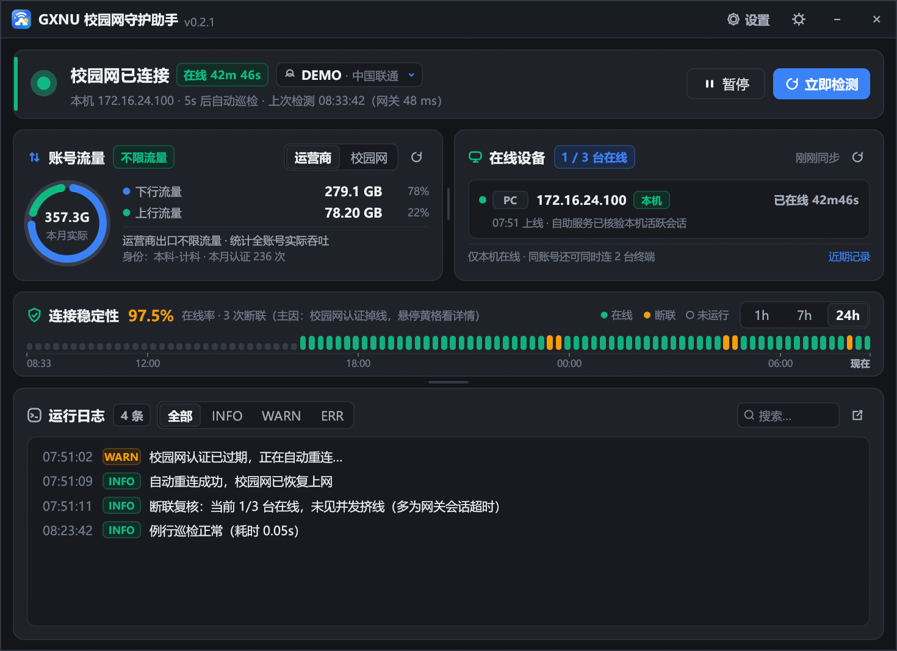
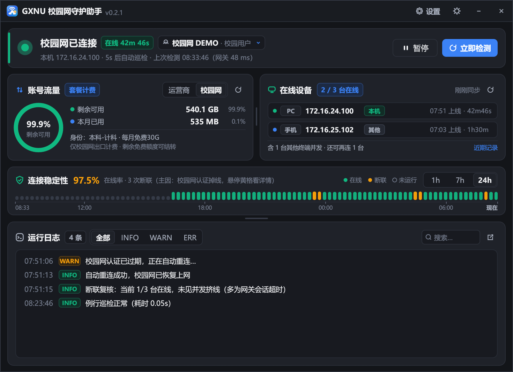
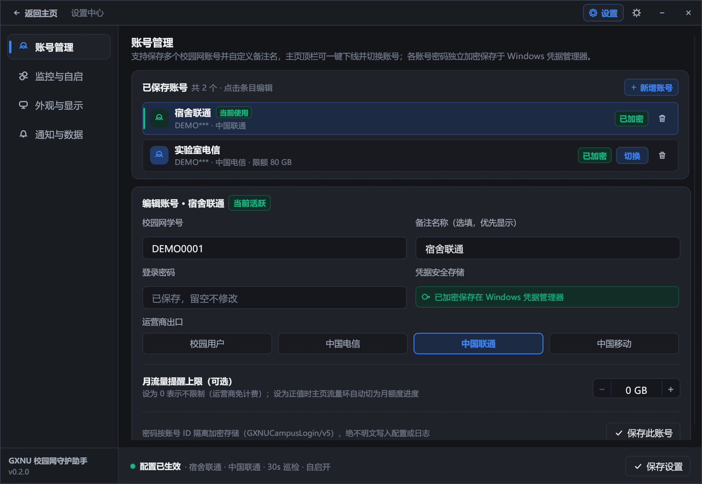
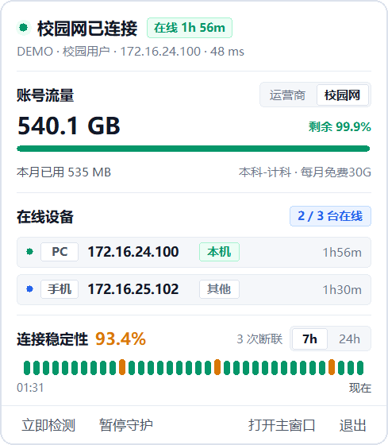
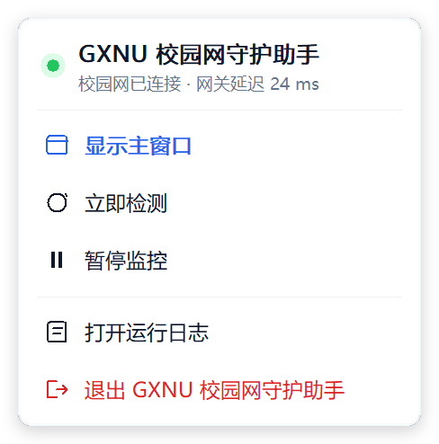

<p align="center">
  
</p>
<h1 align="center">GXNU Campus Network Helper</h1>
<p align="center">A lightweight Windows tray app for Guangxi Normal University’s Dr.COM campus network. Auto-reconnect, self-service traffic & online device sync, instant tray flyout, and 1-click multi-account switching.</p>
<p align="center"><a href="README.md" lang="zh-CN">简体中文</a> · <strong>English</strong></p>
<p align="center">
  <a href="https://github.com/junkaih2019/gxnu-campus-net-helper/releases/latest"><strong>Download Portable Windows x64</strong></a>
  &nbsp;·&nbsp; <a href="CHANGELOG.md">Changelog (Chinese)</a>
  &nbsp;·&nbsp; <a href="docs/CONFIGURATION.md">Configuration (Chinese)</a>
  &nbsp;·&nbsp; <a href="docs/ARCHITECTURE.md">Architecture (Chinese)</a>
  &nbsp;·&nbsp; <a href="LICENSE">MIT License</a>
</p>
<p align="center">
  <sub>Windows 10 / 11 x64 · Single portable executable · No admin required · Built in Rust</sub>
</p>

## Preview

<p align="center">
  <picture>
    <source media="(prefers-color-scheme: dark)" srcset="docs/images/main-window.png">
    <source media="(prefers-color-scheme: light)" srcset="docs/images/main-window-light.png">
    
  </picture>
</p>

The preview adapts automatically to GitHub’s light or dark theme. Screenshots use simulated `DEMO` accounts and network data.

<details>
<summary>Compare light / dark themes, campus multi-device view, and Settings Center</summary>

| Light dashboard (Carrier view) | Dark dashboard (Carrier view) |
| :---: | :---: |
| [](docs/images/main-window-light.png) | [](docs/images/main-window.png) |

| Campus quota & multi-device view | Settings Center (Multi-account) |
| :---: | :---: |
| [](docs/images/main-window-campus.png) | [](docs/images/settings-dark.png) |

Select any screenshot to view it at full size.

</details>

## Features

- **Tiny background footprint; closing the window frees UI memory.** A single Rust executable runs two separate modes. Open the full dashboard on demand; closing it (`×`) exits the UI process immediately and releases OpenGL driver and CJK font memory, leaving only the pure Win32 tray monitor silently running in the background. [Architecture details (Chinese)](docs/ARCHITECTURE.md)
- **Instant Win32 Fluent tray flyout (zero extra RAM).** Left-click the tray icon to open a compact vertical flyout rendered with pure Win32 GDI + DWM native rounded corners. It combines **Account Traffic** (`Carrier / Campus` switchable), **Online Devices**, **Connection Stability** (`7h / 24h` switchable), and a quiet ghost-link footer (`Check Now / Pause / Open Main Window / Exit`) in one glanceable panel. Double-click opens the full dashboard; right-click keeps the compact menu.
- **Read-only GXNU Self-Service integration & dual-perspective traffic.** Connects directly to `http://172.16.4.2/Self/` with a zero-bloat HTML parser, 5-minute per-student cache, and automatic 30-minute silent cooldown on CAPTCHA:
  - **Carrier view** (default for Telecom / Unicom / Mobile broadband): dual-color donut ring displaying full-account monthly downlink/uplink actual traffic, user group identity, and session count.
  - **Campus view** (default for Campus exit, switchable in 1 click): remaining-quota progress ring with official balance, used percentage, user group identity, and free allowance notes.
  - Gracefully falls back to local physical NIC today traffic (excluding Clash / Mihomo / Tailscale TUN adapters) when off-campus or unsynced.
- **Live online devices & concurrency tracking.** Displays active terminals and concurrency quota (e.g. `2 / 3 online`) in strictly aligned columns (terminal type, campus IP, `Local / Other` tag, live duration), with hover access to recent portal sessions and offline root-cause diagnosis when sign-in is rejected.
- **Layered diagnostics & slender high-density stability strip.** Checks adapter → route → public probes → campus portal in order while piercing proxy TUNs to recover your real campus IP. Displays **1h / 7h / 24h** uptime in a slim 96 / 84 / 90-slot vertical capsule timeline with rich outage hover cards.
- **Multi-account profiles & 1-click switching.** Save multiple campus accounts with custom remarks and switch atomically from the Home ribbon (`/drcom/logout` → sign-in → verification). Passwords are stored per account in Windows Credential Manager (`GXNUCampusLogin/v5/<id>`).
- **Denoised logs & flexible layout.** Three-level **`ALL / INFO / WARN / ERR`** logs with click-to-copy, `75%–125%` global zoom (`Ctrl + / − / 0` or `Ctrl + wheel`), and draggable splitters (double-click to restore the default `50:50` symmetrical layout).

## Compatibility

| Item | Support |
| :--- | :--- |
| Campus portal & self-service | Guangxi Normal University Dr.COM portal (`https://yc.gxnu.edu.cn`) & Self-Service (`http://172.16.4.2/Self/`) |
| Carrier exits | Campus (`校园用户`), China Telecom (`中国电信`), China Unicom (`中国联通`), China Mobile (`中国移动`) |
| Platform | Windows 10 / 11 x64 (portable single `.exe`, no installer or admin rights needed) |

## Quick start

1. **Download and extract.** Download the latest Windows x64 ZIP from [GitHub Releases](https://github.com/junkaih2019/gxnu-campus-net-helper/releases/latest), extract it to a **permanent folder**, and run `GXNU 校园网守护助手.exe`.
   > Because this standalone open-source executable is unsigned, Windows SmartScreen may warn on first launch. Verify the `.sha256` checksum from the release first, then select **More info → Run anyway**.
2. **Add your account and start monitoring.** On first launch, the app opens **Settings → 账号管理 (Accounts)**. Enter your student ID, password, optional remark, and carrier exit, then click **保存并开始守护 (Save & start)**.
3. **Glanceable tray flyout & full dashboard.** Close the main window anytime to keep monitoring in the background. **Left-click** the tray icon for the instant vertical flyout; **double-click** or click **打开主窗口** to open the full dashboard.
4. **Startup & display preferences (optional).** Open **设置 (Settings)** to configure startup at sign-in, light/dark theme, global zoom (`75%–125%`), and window size presets.

<details>
<summary>Upgrade from earlier versions or verify a download</summary>

When upgrading from `v0.1.x` / `v0.2.0`:
1. Exit the old tray daemon first (**退出 GXNU 校园网守护助手**);
2. Replace with the new `v0.2.1` executable and launch;
3. Existing accounts, credentials, and telemetry migrate seamlessly (layout preferences auto-migrate to the new `50:50` symmetrical default).

Verify the downloaded ZIP against the release `.sha256` file:

```powershell
Get-FileHash .\gxnu-campus-net-helper-<version>-windows-x64.zip -Algorithm SHA256
```

</details>

## Everyday use and tray experience

### Common actions

| Task | How to do it |
| :--- | :--- |
| Glance at traffic, devices & stability | **Left-click** the tray icon to toggle the instant vertical flyout. Click outside or press `Esc` to dismiss. |
| Open the full dashboard & logs | **Double-click** the tray icon, or click **打开主窗口** in the flyout footer. |
| Keep running with minimal RAM | Close the dashboard (`×`) to free OpenGL & font memory while the Win32 tray daemon stays active. |
| Switch Carrier / Campus traffic view | Click **`运营商 | 校园网`** in either the Home traffic card or the tray flyout. |
| Switch accounts in 1 click | Click the account chip in the Home status ribbon and pick another saved profile. |
| Run a manual or read-only check | Click **立即检测** in the status bar, flyout, or tray menu; pause first for a read-only check. |
| Quit completely | Click **退出** in the flyout footer, or right-click the tray icon and choose **退出 GXNU 校园网守护助手**. |

### Tray quick flyout and right-click menu

Left-click the tray icon for the **vertical quick flyout** (traffic, online devices, stability, and quiet footer actions in one panel); right-click for the **compact context menu**. Both use pure Win32 GDI + DWM native rounded corners and follow your light/dark theme automatically:

<table>
  <tr>
    <th align="center">Left-click · Quick Flyout</th>
    <th align="center">Right-click · Context Menu</th>
  </tr>
  <tr>
    <td align="center" valign="middle">
      <picture>
        <source media="(prefers-color-scheme: dark)" srcset="docs/images/tray-flyout.png">
        <source media="(prefers-color-scheme: light)" srcset="docs/images/tray-flyout-light.png">
        
      </picture>
    </td>
    <td align="center" valign="middle">
      <picture>
        <source media="(prefers-color-scheme: dark)" srcset="docs/images/tray-menu.png">
        <source media="(prefers-color-scheme: light)" srcset="docs/images/tray-menu-light.png">
        
      </picture>
    </td>
  </tr>
</table>

| Icon | Tooltip | Meaning |
| :---: | :--- | :--- |
|  | 网络正常 · Online | Internet probe succeeded. Routine checks continue at the configured interval. |
|  | 检测中 · Checking | A connectivity check is currently running. |
|  | 正在复核 / 正在登录 / 正在验证 | Rechecking a failure, signing in to the portal, or verifying internet access after sign-in. |
|  | 连接异常 · Offline | Confirmed offline. Open the dashboard or flyout to inspect the cause and active devices. |
|  | 已暂停 / 已停止 · Paused / Stopped | Automatic monitoring is inactive. Manual checks remain available. |

## FAQ

**Q: Does Self-Service syncing hammer the campus portal or store sensitive session data?**  
No. It performs read-only whitelist parsing (traffic summary, user group name, active sessions, recent log), never persists passwords, cookies, MACs, or `sessionId`, shares a 5-minute cache per student ID, and silently cools down for 30 minutes if CAPTCHA appears.

**Q: Why does Account Traffic have both "Carrier" and "Campus" views?**  
Carrier broadband exits (Telecom / Unicom / Mobile) are unmetered, whereas the Dr.COM dashboard quota only counts traffic on the campus exit. The app defaults to the view matching your active exit and lets you toggle anytime.

**Q: Does it work alongside Clash / Mihomo (including TUN mode)?**  
Yes. Probes, portal authentication, and self-service requests connect directly, bypassing proxy environment variables and recovering your real campus IP (`172.16.x.x`) through TUN adapters.

**Q: Where are credentials and data stored, and how do I uninstall?**  
Passwords live in Windows Credential Manager (`GXNUCampusLogin/v5/<id>`), and config/logs/telemetry live in `%LOCALAPPDATA%\GXNUCampusLogin\`. Disable auto-start, quit the tray daemon, and delete the `.exe` and data folder to uninstall cleanly.

## Command line and building from source

### Command-line options

| Option | Effect |
| :--- | :--- |
| `--once` | Run one read-only diagnostic check without taking the single-instance lock (`0` online, `2` offline, `3` route changed). |
| `--minimized` | Start silently in the tray without opening the dashboard. |
| `--start` | Start or resume monitoring immediately on launch (combinable with `--minimized`). |
| `--autostart on \| off \| status` | Enable, disable, or query startup at sign-in (`HKCU\...\Run`). |
| `--test-toast` | Send a test Windows notification. |

<details>
<summary>Build the Windows x64 release from source</summary>

Install Rust and 64-bit MinGW-w64, add `gcc`/`dlltool`/`windres` to `PATH` (or set `MINGW_BIN`), and run:

```powershell
rustup toolchain install stable-x86_64-pc-windows-gnu --component rustfmt --component clippy
rustup override set stable-x86_64-pc-windows-gnu
.\build.ps1 verify
.\build.ps1 release
```

</details>

## Documentation and feedback

- [Architecture and diagnostics (Chinese)](docs/ARCHITECTURE.md)
- [Configuration and FAQ (Chinese)](docs/CONFIGURATION.md)
- [Changelog (Chinese)](CHANGELOG.md) · [Contributing (Chinese)](CONTRIBUTING.md) · [Issues](https://github.com/junkaih2019/gxnu-campus-net-helper/issues) · [Security reports (Chinese)](SECURITY.md) · [MIT License](LICENSE)
