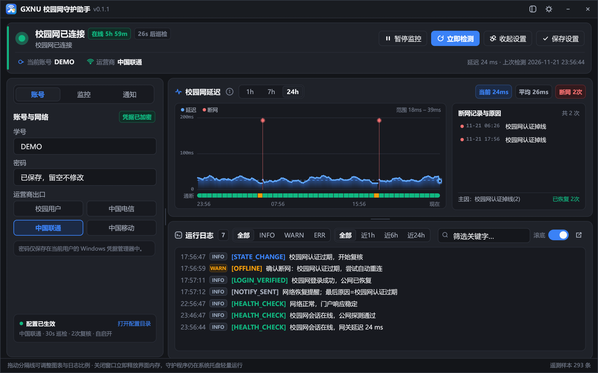

<p align="center">
  
</p>
<h1 align="center">GXNU 校园网守护助手</h1>
<p align="center">广西师范大学校园网的 Windows 托盘工具。自动重连，查看延迟，追踪断网原因。</p>
<p align="center"><strong>简体中文</strong> · <a href="README.en.md" lang="en">English</a></p>
<p align="center">
  <a href="https://github.com/junkaih2019/gxnu-campus-net-helper/releases/latest"><strong>下载 Windows x64 版</strong></a>
  &nbsp;·&nbsp; <a href="CHANGELOG.md">更新记录</a>
  &nbsp;·&nbsp; <a href="LICENSE"></a>
</p>

## 能帮你做什么

- **掉线后自动重连。** 助手检查网卡、路由、公网连通性和校园网门户会话。确认需要认证时，使用已保存的账号登录，再次访问公网以确认恢复。你可以开启 Windows 通知，及时看到断网和恢复提醒。
- **回看什么时候断过网。** 主窗口可切换最近 **1、7 或 24 小时**的门户响应延迟曲线。通断时间轴和断网记录显示异常发生的时刻，运行日志可按时间、级别或关键词筛选。
- **从托盘掌控监控。** 右键托盘图标即可立即检测、暂停或恢复监控、打开日志。关闭主窗口后，后台守护继续工作；再次单击托盘图标即可查看详情。

## 为什么适合校园网

| 遇到的情况 | 助手如何处理 |
| --- | --- |
| 从 Wi-Fi 切换到有线，或电脑刚从睡眠恢复 | 先等网络出口稳定再复查，给系统重新取得路由的时间，减少切网时的误报和重复登录。 |
| 校园网账号仍在线，但网页打不开 | 对照公网探测和门户会话状态。门户确认在线时，标记公网出口异常并等待恢复，避免反复提交密码。 |
| 密码或运营商选错，登录持续被拒 | 首次被拒后静默重试，连续被拒才提醒核对账号。重试间隔逐步延长，最长为 5 分钟。 |
| 只想检查当前连接 | 暂停监控后点击 **立即检测**，助手只读检查一次，监控保持暂停。 |

## 安装与使用

1. 从页首下载链接进入 Releases，下载 Windows x64 的 ZIP 发行包，解压到固定目录，双击 `GXNU 校园网守护助手.exe`。
2. 在 **账号与网络** 中填写自己的校园网学号和密码，选择运营商，点击 **保存并开始守护**。
3. 需要随 Windows 登录启动时，在 **监控** 设置中开启 **开机自动启动到托盘**。如果还希望每次启动后自动开始巡检，同时开启 **启动后立即开始监控**。

要完全退出，右键托盘图标，选择 **退出 GXNU 校园网守护助手**。

<details>
<summary>从 v0.1.0 升级或校验下载文件</summary>

从 v0.1.0 升级时，先从托盘退出旧版，再运行新 EXE。原先开了自启的用户，可在新 EXE 所在目录执行以下 PowerShell 命令更新自启路径。

```powershell
& ".\GXNU 校园网守护助手.exe" --autostart on
```

Release 附有 `.sha256` 校验文件。以下命令以 v0.1.1 为例，输出应与同版本校验文件中的哈希值一致。

```powershell
Get-FileHash .\gxnu-campus-net-helper-0.1.1-windows-x64.zip -Algorithm SHA256
```

</details>

## 界面预览

**主窗口** · 同一屏查看账号设置、门户延迟、断网原因和运行日志。下图的 `DEMO` 账号和网络记录均为演示数据。



**托盘菜单** · 菜单顶部显示当前状态。下图中监控已暂停，仍可执行一次检测。


## 数据与隐私

密码保存在当前 Windows 用户的凭据管理器中。学号与设置保存在 `%LOCALAPPDATA%\GXNUCampusLogin\config.json`，日志和近期网络记录也在该应用目录下。反馈问题时，请只摘录相关日志，并遮盖学号、设备名、IP 和个人目录。[配置与常见问题](docs/CONFIGURATION.md)

## 命令行与源码构建

在 EXE 所在目录打开 PowerShell。常用参数如下。

| 参数 | 用途 |
| --- | --- |
| `--once` | 只读检测。退出码 0 表示在线，2 表示离线，3 表示连续采样时出口发生变化。 |
| `--minimized` / `--minimized --start` | 驻留托盘；加上 `--start` 可在后台开始或恢复监控。 |
| `--test-toast` | 发送一条测试系统通知。 |
| `--autostart status` | 查询开机自启状态。 |

例如，运行 `& ".\GXNU 校园网守护助手.exe" --once` 可做一次只读诊断。

<details>
<summary>在 Windows x64 上构建发行版</summary>

安装 Rust 和 MinGW-w64，将 `gcc`、`dlltool`、`windres` 所在目录加入 PATH，在仓库根目录运行以下命令。

```powershell
rustup toolchain install stable-x86_64-pc-windows-gnu --component rustfmt --component clippy
rustup override set stable-x86_64-pc-windows-gnu
.\build.ps1 verify
.\build.ps1 release
```

`verify` 执行格式检查、Clippy、测试和 Release 构建。`release` 输出 `target\release\GXNU 校园网守护助手.exe`。

</details>

[架构与诊断策略](docs/ARCHITECTURE.md) · [参与贡献](CONTRIBUTING.md) · [安全问题报告](SECURITY.md) · [MIT 许可证](LICENSE)
