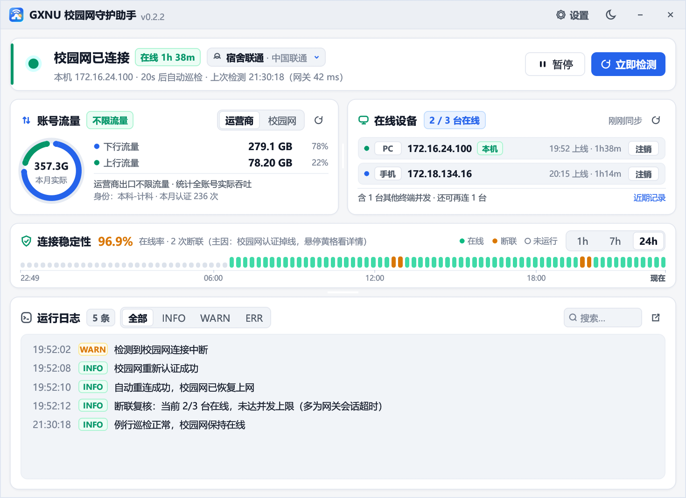
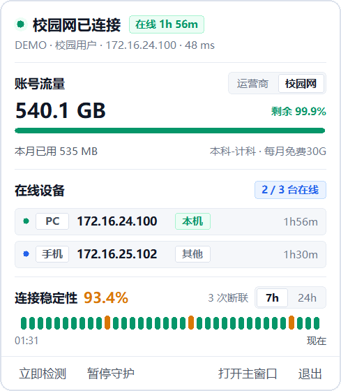
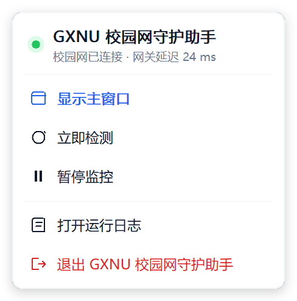
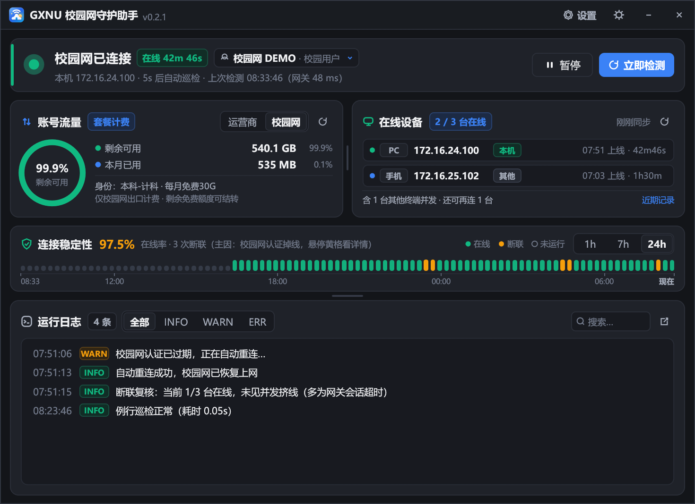

<p align="center">
  
</p>
<h1 align="center">GXNU 校园网守护助手</h1>
<p align="center">广西师范大学校园网（Dr.COM）Windows 轻量托盘工具 —— 断网自动重连、流量与在线设备直查、多账号一键切换</p>
<p align="center"><strong>简体中文</strong> · <a href="README.en.md">English</a></p>
<p align="center">
  <a href="https://github.com/junkaih2019/gxnu-campus-net-helper/releases/latest"><strong>⬇️ 下载 Windows x64 便携版</strong></a>
  &nbsp;·&nbsp; <a href="CHANGELOG.md">更新记录</a>
  &nbsp;·&nbsp; <a href="docs/CONFIGURATION.md">配置说明</a>
  &nbsp;·&nbsp; <a href="docs/ARCHITECTURE.md">架构设计</a>
  &nbsp;·&nbsp; <a href="LICENSE">MIT 许可证</a>
</p>
<p align="center">
  <sub>Windows 10 / 11 x64 · 绿色单文件 · 免安装免管理员 · 支持校园网 / 电信 / 联通 / 移动出口</sub>
</p>

---

## ✨ 界面预览

### 主窗口看板

<p align="center">
  <picture>
    <source media="(prefers-color-scheme: dark)" srcset="docs/images/main-window.png">
    <source media="(prefers-color-scheme: light)" srcset="docs/images/main-window-light.png">
    
  </picture>
</p>

### 托盘交互（左键浮窗 × 右键菜单）

<table>
  <tr>
    <th align="center">🖱️ 左键单击 · 竖版快捷浮窗</th>
    <th align="center">🖱️ 右键单击 · 快捷菜单</th>
  </tr>
  <tr>
    <td align="center" valign="middle">
      <picture>
        <source media="(prefers-color-scheme: dark)" srcset="docs/images/tray-flyout.png">
        <source media="(prefers-color-scheme: light)" srcset="docs/images/tray-flyout-light.png">
        
      </picture>
    </td>
    <td align="center" valign="middle">
      <picture>
        <source media="(prefers-color-scheme: dark)" srcset="docs/images/tray-menu.png">
        <source media="(prefers-color-scheme: light)" srcset="docs/images/tray-menu-light.png">
        
      </picture>
    </td>
  </tr>
</table>

<details>
<summary>🖼️ 展开查看：浅色 / 深色主题对比、校园网多设备视图与设置中心</summary>

| 浅色主窗口（运营商视角） | 深色主窗口（运营商视角） |
| :---: | :---: |
| [](docs/images/main-window-light.png) | [](docs/images/main-window.png) |

| 校园网额度与多终端并发视图 | 设置中心（多账号管理） |
| :---: | :---: |
| [](docs/images/main-window-campus.png) | [](docs/images/settings-dark.png) |

</details>

---

## 💡 核心功能与优势

- 🔄 **断网无感重连**：自动监测网络状态，睡眠唤醒、插拔网线、切换 Wi-Fi 或认证过期时秒级自动重登。
- 📊 **流量与在线设备直查**：直连校园网自助服务，一键切换 **运营商实际吞吐 / 校园网套餐余量**，实时查看当前在线终端与本机 IP。
- ⚡ **托盘左键快捷浮窗**：单击任务栏图标秒弹原生圆角浮窗，不开主窗口也能一屏速览流量、设备与连接稳定性。
- 👥 **多账号一键切号**：支持保存多个校园网账号与自定义备注（如「宿舍联通」「实验室」），顶栏下拉即可自动下线并切号重连。
- 📈 **连接稳定性时间轴**：以 `1h / 7h / 24h` 胶囊时间轴记录在线率，悬停黄格即可查看掉线时间与原因。
- 🛡️ **代理兼容 & 凭据安全**：开启 Clash / Mihomo（含 TUN 模式）照常直连认证；密码加密存入 Windows 凭据管理器，绝不明文落盘。
- 🪶 **极轻后台常驻**：Rust 原生单文件，关闭主窗口即彻底释放图形界面内存，后台仅保留纯 Win32 托盘静默守护。

---

## 🚀 快速开始

1. **下载运行**：前往 [Releases](https://github.com/junkaih2019/gxnu-campus-net-helper/releases/latest) 下载最新 ZIP，解压到**固定目录**，双击运行 `GXNU 校园网守护助手.exe`。
   > 💡 首次运行若弹出 Windows SmartScreen 提示，点击 **更多信息 → 仍要运行** 即可（个人开源单文件未附商业代码签名，可通过随包 `.sha256` 校验完整性）。
2. **添加账号**：首次启动会自动打开 **设置 → 账号管理**，填入校园网学号、密码并选择运营商出口，点击 **保存并开始守护**。
3. **日常使用**：
   - **平时直接关掉主窗口（`×`）**，程序会在托盘极轻常驻；
   - **左键单击**托盘图标秒开快捷浮窗，**左键双击**打开完整主窗口，**右键单击**呼出快捷菜单；
   - 如需开机自启，在主窗口右上角 **设置 → 监控与自启** 中勾选并保存即可。

### 托盘状态指示

|  正常 |  检测中 |  重连恢复中 |  连接异常 |  已暂停 |
| :---: | :---: | :---: | :---: | :---: |
| 公网连通正常 | 正在例行探测 | 复核 / 登录 / 验证中 | 离线或认证被拒 | 自动守护已暂停 |

---

## ❓ 常见问题

- **为什么账号流量有「运营商」和「校园网」两个切换项？**  
  师大电信/联通/移动宽带出口通常不限流量，而自助服务套餐余量仅统计「校园网出口」额度。程序默认匹配你当前账号的出口视角，也可随时点击右上角一键切换。
- **开着 Clash / Mihomo 代理（或 TUN 模式）会影响自动登录吗？**  
  不会。探测、认证与自助服务查询均绕过系统代理直连，并能穿透虚拟网卡识别真实校园网 IP。
- **账号密码存在哪里？如何升级或卸载？**  
  密码由 Windows 凭据管理器加密保存，配置与日志位于 `%LOCALAPPDATA%\GXNUCampusLogin\`。升级时先退出托盘旧版再替换 EXE 即可自动继承数据；卸载时关闭开机自启、退出程序并删除 EXE 与上述目录即可。

---

## 🛠️ 进阶与文档

<details>
<summary>⌨️ 命令行参数与源码构建</summary>

### 常用命令行参数

| 参数 | 说明 |
| :--- | :--- |
| `--minimized --start` | 静默启动到托盘并立即开始守护 |
| `--once` | 执行一次只读网络诊断（退出码：`0` 在线、`2` 离线、`3` 路由变化） |
| `--autostart on \| off \| status` | 开启、关闭或查询开机自启 |
| `--test-toast` | 发送一条测试系统通知 |

### 从源码构建（Windows x64 + MinGW-w64）

```powershell
rustup toolchain install stable-x86_64-pc-windows-gnu --component rustfmt --component clippy
rustup override set stable-x86_64-pc-windows-gnu
.\build.ps1 verify
.\build.ps1 release
```

</details>

- 📖 [配置与使用说明](docs/CONFIGURATION.md) · [架构与诊断策略](docs/ARCHITECTURE.md) · [更新记录](CHANGELOG.md)
- 🤝 [参与贡献](CONTRIBUTING.md) · [问题反馈 (Issues)](https://github.com/junkaih2019/gxnu-campus-net-helper/issues) · [安全报告](SECURITY.md) · [MIT 许可证](LICENSE)
