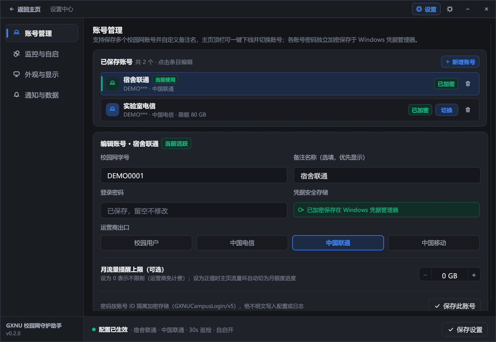

<p align="center">
  
</p>
<h1 align="center">GXNU 校园网守护助手</h1>
<p align="center">广西师范大学校园网（Dr.COM）Windows 托盘守护工具。断网自动重连、自助服务流量与在线终端直查、托盘快捷浮窗、多账号一键切换。</p>
<p align="center"><strong>简体中文</strong> · <a href="README.en.md" lang="en">English</a></p>
<p align="center">
  <a href="https://github.com/junkaih2019/gxnu-campus-net-helper/releases/latest"><strong>下载 Windows x64 便携版</strong></a>
  &nbsp;·&nbsp; <a href="CHANGELOG.md">更新记录</a>
  &nbsp;·&nbsp; <a href="docs/CONFIGURATION.md">配置说明</a>
  &nbsp;·&nbsp; <a href="docs/ARCHITECTURE.md">架构文档</a>
  &nbsp;·&nbsp; <a href="LICENSE">MIT 许可证</a>
</p>
<p align="center">
  <sub>Windows 10 / 11 x64 · 绿色单文件 · 免管理员权限 · Rust 原生构建</sub>
</p>

## 界面预览

<p align="center">
  <picture>
    <source media="(prefers-color-scheme: dark)" srcset="docs/images/main-window.png">
    <source media="(prefers-color-scheme: light)" srcset="docs/images/main-window-light.png">
    
  </picture>
</p>

主窗口预览随 GitHub 浅色 / 深色模式自动切换。图中均使用 `DEMO` 演示账号与模拟数据。

<details>
<summary>展开查看浅色 / 深色双主题、校园网多终端视图与设置中心</summary>

| 浅色主窗口（运营商视角） | 深色主窗口（运营商视角） |
| :---: | :---: |
| [](docs/images/main-window-light.png) | [](docs/images/main-window.png) |

| 校园网额度与多终端并发视图 | 设置中心（多账号管理） |
| :---: | :---: |
| [](docs/images/main-window-campus.png) | [](docs/images/settings-dark.png) |

点击任意截图可查看原图。

</details>

## 核心特性

- **极轻常驻，关窗即释放内存。** 单文件双模式 Rust 原生架构。查看完整看板或修改设置时按需打开主窗口；关闭主窗口（`×`）后界面进程立即退出，完全释放 OpenGL 驱动与中文字库内存，仅保留极轻量的纯 Win32 托盘守护进程在后台静默运行。[架构与测量口径](docs/ARCHITECTURE.md)
- **托盘左键竖版快捷浮窗（零额外内存瞬时弹出）。** 单击任务栏图标即在托盘上方秒弹纯 Win32 GDI + DWM 原生圆角浮窗，一屏融合 **账号流量（运营商 / 校园网可切换）**、**在线设备**、**连接稳定性（7h / 24h 可切换）** 与底部静谧操作栏（`立即检测 / 暂停守护 / 打开主窗口 / 退出`）；双击图标可直开完整主窗口，右键保留轻量快捷菜单。
- **校园网自助服务只读直查与双口径流量视图。** 轻量接入 `http://172.16.4.2/Self/`（零重型 HTML 解析依赖，5 分钟按学号共享缓存，触发验证码自动 30 分钟静默冷却）：
  - **运营商视角**（电信 / 联通 / 移动宽带默认）：蓝/绿双色环形图展示本月全账号实际下行/上行总流量、用户身份与本月认证次数。
  - **校园网视角**（校园用户默认，支持右上角一键切换）：余量进度环形图展示官方剩余可用额度、已用占比、用户身份与免费套餐说明。
  - 离校或暂未同步时自动降级展示本机物理网卡今日流量参考（自动排除 Clash / Mihomo / Tailscale TUN 虚拟网卡）。
- **在线设备与并发上限一目了然。** 实时展示当前学号在线终端数与并发配额（如 `2 / 3 台在线`），以统一栅格列对齐终端类型（`PC` / `手机`）、校园网 IP、`本机 / 其他` 身份与在线时长；支持悬停页脚 `近期记录` 查看门户历史会话，登录被拒时自动离线定位「流量用尽」或「并发占线 IP」。
- **分层诊断与高密度纤细胶囊稳定性带。** 切换 Wi-Fi、插拔网线或睡眠唤醒后，按「网卡 → 路由 → 公网探测 → 校园网门户」逐层排查，自动穿透代理 TUN 提取真实校园网 IP；提供 **1h / 7h / 24h** 纤细竖向胶囊时间轴（96 / 84 / 90 槽位），悬停任意黄色断点即可弹出结构化断联详情卡片。
- **多账号管理、自定义备注与一键切号。** 支持保存多个校园网账号与自定义备注名，主页顶栏下拉一键执行 Dr.COM 下线（`/drcom/logout`）→ 切号重登 → 公网复验；各账号密码按 `GXNUCampusLogin/v5/<账号ID>` 独立加密存储于 Windows 凭据管理器，绝不明文落盘。
- **精简降噪运行日志与自由布局。** 按 **`全部 / INFO / WARN / ERR`** 严格三层分级并过滤噪音，单击即复制；支持 `75%–125%` 全局缩放（`Ctrl + / − / 0` 或 `Ctrl + 滚轮`）、窗口尺寸记忆与面板分隔条自由拖拽（双击恢复默认 `50:50` 对称布局）。

## 适用范围

| 项目 | 支持情况 |
| :--- | :--- |
| 认证门户与自助服务 | 广西师范大学 Dr.COM 认证系统（`https://yc.gxnu.edu.cn`）与校园网自助服务（`http://172.16.4.2/Self/`） |
| 运营商出口 | 校园用户、中国电信、中国联通、中国移动 |
| 运行环境 | Windows 10 / 11 x64（绿色单文件，免安装、无需管理员权限） |

## 快速开始

1. **下载并解压。** 前往 [GitHub Releases](https://github.com/junkaih2019/gxnu-campus-net-helper/releases/latest) 下载最新 Windows x64 ZIP 压缩包，解压到**固定目录**（避开临时目录，以免影响自启路径），双击运行 `GXNU 校园网守护助手.exe`。
   > 首次运行如触发 Windows SmartScreen（「Windows 已保护你的电脑」），是因为个人开源单文件未购买商业代码签名。可先核对 Release 附带的 `.sha256` 校验值，再点击「更多信息 → 仍要运行」。
2. **添加账号并开始守护。** 首次运行时会自动进入 **设置中心 → 账号管理**。填写校园网学号、登录密码、可选备注名并选择运营商出口，点击右下角 **保存并开始守护** 后自动回到主页并开始同步自助服务数据。
3. **日常一秒速览与切号。** 平时可关闭主窗口让程序静默驻留托盘；需要查看流量、在线设备或稳定性时，**左键单击托盘图标**即可秒弹竖版快捷浮窗；需要切换账号或查看详细日志时，双击托盘图标或点击浮窗底部 **打开主窗口**。
4. **设置开机自启与界面偏好（可选）。** 点击顶栏右侧 **设置**：
   - 在 **监控与自启** 中开启 **开机自动启动到托盘** 与 **启动后立即开始监控**，点击右下角 **保存设置**；
   - 在 **外观与显示** 中可随时调整浅/深色主题、界面缩放比例（`75%–125%`）、窗口尺寸预设以及是否在主页显示「账号流量与在线设备」卡片。

<details>
<summary>从旧版本升级或校验下载文件</summary>

从 `v0.1.x` / `v0.2.0` 升级时：
1. 先右键旧版系统托盘图标选择 **退出 GXNU 校园网守护助手**；
2. 用新版 `GXNU 校园网守护助手.exe` 覆盖或放到固定目录后启动；
3. 原有账号配置、凭据与历史遥测会自动平滑保留，同时自动迁移至 `v0.2.1` 默认 `50:50` 对称布局。

如果原先开启过开机自启且更换了目录，可在新版 EXE 所在目录运行以下 PowerShell 命令刷新自启路径：

```powershell
& ".\GXNU 校园网守护助手.exe" --autostart on
```

每个 Release 均附带 `.sha256` 校验文件。下载后可在压缩包所在目录运行以下命令比对哈希（将 `<版本号>` 替换为实际版本）：

```powershell
Get-FileHash .\gxnu-campus-net-helper-<版本号>-windows-x64.zip -Algorithm SHA256
```

</details>

## 日常使用与托盘交互

### 常用操作

| 你想做什么 | 操作方式 |
| :--- | :--- |
| 一秒速览流量、设备与稳定性 | **左键单击** 任务栏托盘图标，秒弹竖版快捷浮窗；点浮窗外、按 `Esc` 或再次单击图标即收起。 |
| 打开完整主窗口与运行日志 | **左键双击** 托盘图标，或点击快捷浮窗底部的 **打开主窗口**。 |
| 放到后台极轻常驻 | 关闭主窗口（`×`）即可释放全部图形界面内存，纯 Win32 托盘守护继续静默运行。 |
| 切换运营商 / 校园网流量视角 | 在主窗口「账号流量」卡或托盘浮窗顶部点击 **`运营商 | 校园网`** 按钮即可即时切换。 |
| 一键切换校园网账号 | 点击主页顶部状态条中的账号胶囊，在下拉菜单中直接点击目标账号即可自动下线并切换登录。 |
| 随时手动检测 / 只读检测 | 点击状态条、浮窗底栏或右键菜单中的 **立即检测**；先 **暂停守护** 再检测则仅只读诊断、不触发自动登录。 |
| 排查上次掉线原因 | 切换 `1h / 7h / 24h` 悬停黄色胶囊查看完整断联详情卡；在下方运行日志切换 `WARN / ERR` 或搜索关键字。 |
| 彻底退出程序 | 点击托盘浮窗右下角 **退出**，或右键托盘图标选择 **退出 GXNU 校园网守护助手**。 |

### 托盘快捷浮窗与右键菜单

左键单击托盘图标弹出**竖版快捷浮窗**（一屏聚合流量、在线设备与稳定性，支持直接切换视角与快捷操作），右键单击弹出**轻量快捷菜单**；两者均采用纯 Win32 GDI + DWM 原生圆角渲染，自动跟随浅色 / 深色主题：

<table>
  <tr>
    <th align="center">左键单击 · 竖版快捷浮窗</th>
    <th align="center">右键单击 · 快捷菜单</th>
  </tr>
  <tr>
    <td align="center" valign="middle">
      <picture>
        <source media="(prefers-color-scheme: dark)" srcset="docs/images/tray-flyout.png">
        <source media="(prefers-color-scheme: light)" srcset="docs/images/tray-flyout-light.png">
        
      </picture>
    </td>
    <td align="center" valign="middle">
      <picture>
        <source media="(prefers-color-scheme: dark)" srcset="docs/images/tray-menu.png">
        <source media="(prefers-color-scheme: light)" srcset="docs/images/tray-menu-light.png">
        
      </picture>
    </td>
  </tr>
</table>

应用图标右下角的圆点代表当前状态，鼠标悬停可查看完整提示（格式为 `GXNU 校园网守护助手：<状态>`）：

| 图标 | 悬停状态 | 含义 |
| :---: | :--- | :--- |
|  | 网络正常 | 公网探测通过，按设定间隔继续巡检。 |
|  | 检测中 | 正在检测当前网络连接，等待本轮结果。 |
|  | 正在复核 / 正在登录 / 正在验证 | 依次表示复查异常、提交门户认证、登录后复验公网连通性；复核通过也可直接恢复正常。 |
|  | 连接异常 | 已判定离线。打开主窗口或托盘浮窗查看原因与占线终端。 |
|  | 已暂停 / 已停止 | 自动监控未运行。暂停期间仍可手动检测，或从托盘恢复监控。 |

## 常见问题

**Q：自助服务查询会频繁请求学校服务器或泄露账号信息吗？**  
不会。自助服务客户端为**纯只读白名单解析**，仅读取流量汇总、用户组身份、在线终端列表与近期记录，绝不落盘密码、`sessionId`、MAC 或 Cookie；按学号共享 **5 分钟低频缓存**（手动刷新 15 秒防抖），绝不跟随 10 秒例行巡检，若门户要求验证码则自动进入 30 分钟静默冷却。

**Q：为什么办了电信/联通/移动宽带后，账号流量有「运营商」和「校园网」两个视角？**  
广西师大校园网的运营商宽带出口通常不限流量，而自助服务首页「已用/剩余流量」仅统计校园网出口的免费套餐额度。因此本工具同时支持两个视角：运营商账号默认展示全账号本月实际上下行吞吐，校园网出口默认展示免费套餐剩余比例，也可随时一键切换。

**Q：同时开启 Clash / Mihomo 等代理（含 TUN 模式）会影响使用吗？**  
不会。公网探测、门户认证与自助服务查询均直连系统路由，忽略代理环境变量，并自动穿透虚拟隧道网卡提取真实校园网 IP（如 `172.16.x.x`）。

**Q：多账号密码和运行数据存在哪里？如何彻底卸载？**  
各账号密码按 ID 独立加密保存在当前 Windows 用户的凭据管理器中（`GXNUCampusLogin/v5/<账号ID>`），配置文件、界面偏好、日志与遥测位于 `%LOCALAPPDATA%\GXNUCampusLogin\`。卸载时关闭开机自启、退出托盘程序并删除 EXE 与该目录即可。

更多配置字段（`config.json`、`ui_prefs.json`、`traffic.json`）与环境变量说明请参阅 [配置与使用说明](docs/CONFIGURATION.md)。

## 进阶：命令行与源码构建

### 命令行参数

在 EXE 所在目录打开 PowerShell，可使用以下常用参数：

| 参数 | 用途 |
| :--- | :--- |
| `--once` | 执行一次只读诊断（不占用单实例锁，也不提交凭据）。退出码：`0` 在线、`2` 离线、`3` 连续采样期间出口发生变化。 |
| `--minimized` | 静默启动并驻留托盘，不弹出主窗口。 |
| `--start` | 启动后立即开始或恢复监控，可与 `--minimized` 组合为 `--minimized --start`。 |
| `--autostart on \| off \| status` | 开启、关闭或查询开机自启状态（开启时会将当前 EXE 路径写入 `HKCU\...\Run`）。 |
| `--test-toast` | 发送一条测试 Windows 系统通知。 |

> **提示：** 发行版 EXE 为 Windows GUI 子系统程序，在 PowerShell 中直接运行不会自动回显标准输出或阻塞等待。如需查看输出并获取真实退出码，请通过管道调用，例如：
> ```powershell
> & ".\GXNU 校园网守护助手.exe" --once | Out-Host; $LASTEXITCODE
> ```

<details>
<summary>在 Windows x64 上从源码构建</summary>

安装 Rust 与 64 位 MinGW-w64，将 `gcc`、`dlltool`、`windres` 所在目录加入 `PATH`（或通过环境变量 `MINGW_BIN` 指定），在仓库根目录运行：

```powershell
rustup toolchain install stable-x86_64-pc-windows-gnu --component rustfmt --component clippy
rustup override set stable-x86_64-pc-windows-gnu
.\build.ps1 verify
.\build.ps1 release
```

`verify` 依次执行格式检查、Clippy、测试与 Release 构建；`release` 会嵌入图标与版本信息并输出 `target\release\GXNU 校园网守护助手.exe`。

</details>

## 相关文档与反馈

- [架构与诊断策略](docs/ARCHITECTURE.md) — 双模式进程分离、IPC 协议、分层诊断状态机与退避策略
- [配置与使用说明](docs/CONFIGURATION.md) — 运行时文件、`config.json` 多账号字段、调试环境变量与 FAQ
- [更新记录](CHANGELOG.md) · [参与贡献](CONTRIBUTING.md) · [反馈问题 (Issues)](https://github.com/junkaih2019/gxnu-campus-net-helper/issues) · [安全问题报告](SECURITY.md) · [MIT 许可证](LICENSE)
