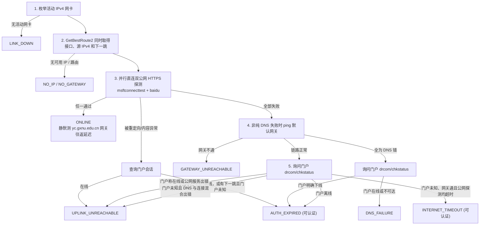

# 架构与设计文档

本文档说明 `gxnu-guard` 的双模式进程架构、本地 IPC 通信、分层网络诊断状态机以及图形与托盘渲染设计。

---

## 1. 单文件「轻守护 + 按需界面」双模式架构

在 Windows 上，任何基于 OpenGL（`eframe / glow`）的 GUI 进程一旦创建窗口，就会载入显卡 OpenGL ICD 驱动（如 Intel `igc64.dll` ~55 MB）并在进程堆中常驻中文字库（`msyh.ttc` ~19 MB），即使隐藏窗口也无法由进程自身完全卸载驱动映射。

为兼顾**全天候极低后台占用**与**现代流畅的监控界面**，`gxnu-guard.exe` 内部采用单二进制双模式分离：

| 运行模式 | 启动方式 | 职责 | 典型内存（Private / WS） | 后台 CPU |
| :--- | :--- | :--- | :--- | :--- |
| **轻守护进程（Daemon）** | `gxnu-guard.exe` 或 `--minimized` | 持有单实例锁 `Local\GXNUCampusLoginRS`、监控线程、Toast 通知、托盘图标与 Fluent 右键菜单、本地 IPC 服务端 | **~2.9 MB / ~5.8 MB** | **0.0%** |
| **按需界面进程（UI）** | 守护进程按需拉起 `--ui --ipc-port <P> --ipc-token <T>` | 持有 UI 锁 `Local\GXNUCampusLoginRS_UI`、连接守护 IPC、展示双主题看板与设置页；点击 `×` 即退出彻底释放全部 GPU/字库内存 | 打开时 ~114 MB / 关闭后 **0 MB** | 仅可见时 1 FPS |

### 生命周期流转

1. **首次启动**：
   - 普通启动：轻守护进程就绪后自动拉起 `--ui` 子进程显示主窗口。
   - `--minimized` 启动（开机自启）：仅启动轻守护进程静默驻留系统托盘。
   - 重复双击 `gxnu-guard.exe`：检测到 `Local\GXNUCampusLoginRS` 已存在时，读取 `daemon.json` 向运行中的守护发送 `ShowUi` 指令，直接前置或拉起主窗口后退出。
2. **关闭主窗口（`×`）**：`--ui` 进程直接退出，释放全部 OpenGL 上下文与字库内存；守护进程继续在托盘实时监测并在断网时弹出 Windows Toast 通知。
3. **托盘完全退出**：通过守护进程托盘右键菜单点击「退出校园网守护」：
   - 向已连接的 `--ui` 客户端广播 `Shutdown`；
   - 隐藏并销毁自定义 Fluent 菜单窗口与托盘图标（避免通知区残留幽灵图标）；
   - 在 600ms 内等待 `--ui` 退出，必要时终止；
   - 有界停止监控线程（最多等待 800ms，防止进行中的网络请求卡死退出）。

---

## 2. 本地回环 IPC 协议 (`src/ipc.rs`)

- **传输层**：守护进程绑定 `127.0.0.1:0`（系统分配临时端口），生成随机会话令牌 `token`，写入 `%LOCALAPPDATA%\GXNUCampusLogin\daemon.json`（退出时自动删除）。
- **帧格式**：UTF-8 JSON Lines（每行一条 JSON 消息，`\n` 分隔）。
- **认证**：客户端建立连接后的首条消息必须携带匹配 `token` 的 `Hello`，否则服务端立即断开。

每个界面连接使用独立的写线程和有界队列。队列满或写入超时时，守护会断开该客户端。快照携带独立的监控开关和最近一次检测结果。

### 消息类型

客户端先发送握手帧 `{"cmd":"Hello","token":"..."}`。守护完成控制器初始化后才处理命令。命令通过 `Request` 发送，同一连接上的请求使用独立递增序号，例如：

```json
{"cmd":"Request","id":1,"command":{"cmd":"Start"}}
```

支持 `ShowUi`、`Start`、`Pause`、`ForceCheck`、`ReloadSettings` 和 `TestToast`。`ReloadSettings` 携带保存后的非敏感设置、密码是否变更和是否立即开始监控。守护读取并核对磁盘配置，依次应用设置与启动操作。读取、解析或核对失败时继续使用上一次配置。

执行结果仅发回请求所在连接。成功示例为 `{"type":"CommandResult","id":1,"result":{"Ok":null}}`，失败时 `result.Err` 给出原因。界面和重复启动的命令行进程最多等待回执 4 秒。广播仍使用 `Snapshot`、`LogLine` 和 `Shutdown`。

---

## 3. 分层诊断与监控状态机 (`src/diagnostics.rs`, `src/monitor.rs`)

### 诊断顺序



### 校园网认证网关延迟测量 (`src/campus_status.rs`)

- 公网巡检或登录复验确认恢复时，先发布 `ONLINE` 快照。随后由单个后台线程调用 `CampusStatusProbe::measure_rtt_ms()`，复用直连无代理的 `ureq::Agent` 对 `https://yc.gxnu.edu.cn/drcom/chkstatus` 发起一次轻量 GET，记录收到完整 HTTP 响应的往返耗时（毫秒）。
- **为何不用纯 TCP `connect`**：在本机启用 Mihomo / Clash 等 TUN 虚拟网卡（Fake-IP 段 `198.18.0.0/15`）时，虚拟网卡会在本地 1ms 内直接回复 TCP SYN-ACK，导致纯 TCP 握手测出假的 `1ms`；等待应用层完整响应才能准确反映本机到校园网认证网关的真实延迟。

每次检测有独立的采样 ID，界面在同一采样上更新延迟。下一轮开始或状态轮次失效时，尚未返回的测量按缺测写入。迟到结果会被丢弃，每个检测点只写一次。

### 网络切换与睡眠恢复

Windows 接口变化或系统恢复消息一到托盘线程就使旧检测失效。监控线程合并相邻事件，安静 750 毫秒后只读复查。公网恢复时立即更新在线状态。若仍失败，会在第 2 秒和第 5 秒附近重新探测。同一出口收到连续通知时，最多延后 10 秒进入确认阶段。慢探针完成后仍需采用新一轮的结果。暂停期间只执行已请求的检查。[Windows 接口变化通知](https://learn.microsoft.com/en-us/windows/win32/api/netioapi/nf-netioapi-notifyipinterfacechange)

巡检、手动检测及登录复验在开始、结束时读取出口路由，登录还在提交凭据前再次核对。每次查询同时取得接口 LUID、源 IPv4 和下一跳。任一项改变就丢弃旧结论，在新出口重新取样。直连路由的下一跳可以为零，可通过公网探测确认在线。[Windows GetBestRoute2](https://learn.microsoft.com/en-us/windows/win32/api/netioapi/nf-netioapi-getbestroute2)

切换期间的失败仅写入 `[NETWORK_SWITCH]` 诊断日志。界面显示“网络切换中”，这些结果不触发通知、凭据提交或断网统计。出口稳定后按 `confirm_failures` 复核。门户明确下线时沿用登录退避，门户在线时报告出口或 DNS 故障。门户未知时，混合 DNS 与连接错误只报告公网异常。确有重定向证据或网关可达且公网探测均超时时，需要在同一出口复查后才可沿用认证策略。


### 重连退避与防误报策略

- 公网探测收到首个成功结果即可结束。失败时收集全部证据。网关延迟缺测会在曲线上留空，同时保留公网通断记录。
- 暂停、停止、网络变化及修改监控参数或凭据会使正在进行的检测轮次失效。修改通知偏好可保留当前轮次。暂停时的手动检测只更新结果，监控开关保持关闭。学号与已保存凭据必须匹配才能登录。
- **连续失败复核**：连续 `confirm_failures`（默认 `2`）次检测失败才从 `ONLINE → SUSPECT → OFFLINE`，避免单次网络抖动误报。
- **静默首次重登**：仅对可认证结论提交凭据；认证首次被拒不立刻告警，连续 `2` 次失败才记录拒绝原因。
- **登录后快速两段复验**：认证接口返回成功后先等 `1` 秒立即复验，若门户尚未放行完再隔 `1.5` 秒复验一次，确认公网真正连通即切回 `ONLINE`（Windows Toast 通知异步发送，不阻塞重连链路）。
- 登录失败后的等待时间按 `[5, 15, 30, 60, 300]` 秒递增。每次提交前会检查单调时钟。手动检测、暂停后恢复和通知偏好变更都保留当前截止时间。修改有效账号、密码或运营商后，按新凭据重新评估。

---

## 4. 原生托盘图标与 Windows 11 Fluent 右键菜单

- **程序化统一图标 (`src/app_icon.rs`, `build.rs`)**：
  - 采用纯 SDF（有向距离场）+ 3×3 超采样抗锯齿绘制 GXNU 主题圆角矩形图标（清爽晴空蓝渐变、独秀峰与王城拱门、暖阳星芒、圆头 Wi-Fi 波纹）。
  - 托盘态在右下角叠加白边状态圆点，实时随 `MonitorState` 更新。
  - 编译期通过 `build.rs` 调用 MinGW `windres` 将 `assets/app.ico`（6 档分辨率 PNG-in-ICO）链接进 `gxnu-guard.exe` 的 PE 资源节。
- **Fluent 自定义托盘菜单 (`src/tray_menu.rs`)**：
  - 守护进程启用 `Per-Monitor V2` DPI 感知，使用纯 Win32 GDI 双缓冲绘制现代弹出菜单，无需 OpenGL。
  - 通过 `DwmSetWindowAttribute` 启用 Windows 11 原生圆角（`DWMWCP_ROUND`）、阴影与主题边框色，自动读取 `ui_prefs.json` 或系统 `AppsUseLightTheme` 同步浅/深色外观。
  - 守护主线程使用阻塞式 `GetMessageW` 消息循环，平时零轮询、零 CPU 消耗。
